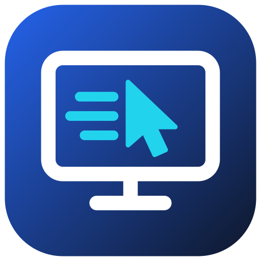

# glidedesk



A remote desktop for Linux that aims to feel like Windows RDP, or better:

- **The whole session is GPU-rendered**: each user gets a headless GNOME Shell (Wayland)
  composited on the GPU, with no physical monitor, dummy plug or virtual display driver.
- **The desktop follows the client window**: resize the window and the remote resolution
  changes.
- **Hardware video end to end**: NVENC on NVIDIA, VA-API on AMD and Intel (x264 on the CPU
  when there is no usable GPU), low-latency settings, frames encoded as soon as the
  compositor produces them, up to the client's refresh rate (144 Hz and more).
- **Two ways in, at the same time**:
  - **Standard RDP** (port 3389): the Windows Remote Desktop client (`mstsc`), Microsoft's
    Windows App (macOS, iOS, Android) and FreeRDP/Remmina work without installing anything.
  - **glidedesk's own low-latency protocol** (port 3391): video over UDP with Reed-Solomon
    FEC (a lost packet never stalls the picture), HEVC or H.264, everything else over TLS.
    Used by the glidedesk clients for Windows, Linux, Android and Termux.
  - **Any web browser** (port 3390): open `https://<server>:3390`, log in, done. WebRTC
    carries the same hardware-encoded video (HEVC where the browser decodes it, else H.264),
    Opus sound, and the input; WebRTC's congestion control sets the bitrate.
- **No fixed bandwidth**: frames are encoded at a constant quality, so a still desktop costs
  almost nothing; only the ceiling a frame may reach follows the link, from the measured
  delay (it drops as soon as frames queue, and climbs back while the link is clean).

**Status: early development (v0.2).** Tested on Ubuntu 24.04 (GNOME 46) with NVIDIA GPUs.

## Which client?

| | `mstsc` / Windows App / FreeRDP (RDP) | glidedesk clients (native protocol) | Web browser (WebRTC) |
|---|---|---|---|
| Install | nothing (built into Windows) | one program (Windows, Linux, Android, Termux) | nothing |
| Transport | TCP (TLS) | video over UDP with FEC, the rest over TLS | WebRTC (UDP, DTLS-SRTP) |
| On a lossy link (Wi-Fi, mobile) | a lost packet stalls everything until it is resent | the picture keeps going | retransmission and keyframe requests, as video calls |
| Codec | H.264 4:2:0 | HEVC (where the client decodes it in hardware) or H.264 | HEVC (Chrome, Edge, Safari with hardware support) or H.264 |
| Decoding | the client's | on the GPU (D3D11VA on Windows, VA-API or NVDEC on Linux, MediaCodec on Android) | the browser's (GPU where available) |
| Refresh rate | the server's (`--refresh`, default 120) | the client's screen (60, 120, 144 Hz...) | the server's |
| Desktop follows the window | FreeRDP: yes. `mstsc`: not yet | yes | yes |
| Sound | yes | yes (desktop and Termux clients) | yes (Opus) |
| Clipboard (text) | yes | yes (desktop client) | not yet |
| Pointer | drawn by the client | drawn by the client | drawn by the browser |

Use RDP or the browser when you cannot install anything; use the glidedesk client for the
lowest latency, especially over Wi-Fi or the Internet.

## Download

Prebuilt binaries are on the [releases page](https://github.com/PabloSoage/glidedesk/releases):

| File | What |
|---|---|
| `glidedesk-host-linux-x86_64` | the server (Ubuntu 24.04 / GNOME 46, x86-64) |
| `glidedesk-session.sh` | starts the headless GNOME session the server runs in |
| `glidedesk-windows-x86_64.exe` | desktop client for Windows |
| `glidedesk-linux-x86_64` | desktop client for Linux (Wayland or X11; uses the system FFmpeg 6, as on Ubuntu 24.04: `sudo apt install libavcodec60`) |
| `glidedesk-android.apk` | Android client (RDP or native protocol) |
| `glidedesk-x11-termux-aarch64` | client for Termux with termux-x11 (Android, arm64) |
| `glidedesk-x11-linux-x86_64` | the same small X11 client for Linux machines without a GPU |

## Server

Requirements: Ubuntu 24.04 with GNOME 46 (other distributions with GNOME 46+ should work), and
for hardware encoding the NVIDIA driver (570 or later) or Mesa / Intel media VA-API drivers.

```sh
sudo apt install gnome-shell pipewire wireplumber dbus-daemon ffmpeg libopus0
chmod +x glidedesk-host-linux-x86_64 glidedesk-session.sh
# Your Linux user name and a password for remote clients (not your login password,
# unless you want it to be):
export GLIDEDESK_PASSWORD='choose-a-password'
./glidedesk-session.sh -- ./glidedesk-host-linux-x86_64 serve
```

`glidedesk-session.sh` starts a private headless GNOME Shell on its own D-Bus session (it does
not touch a desktop session you may already have) and runs the server next to it. Clients log
in with your Linux user name and `GLIDEDESK_PASSWORD`.

Open the ports if a firewall is active: **3389/tcp** (RDP), **3391/tcp + 3391/udp**
(native protocol) and **3390/tcp + 3390/udp** (web client), e.g.
`sudo ufw allow 3389/tcp && sudo ufw allow 3391 && sudo ufw allow 3390`.

Useful options of `serve` (`--help` lists them all):

| Option | Default | |
|---|---|---|
| `--encoder auto\|nvenc\|vaapi\|software` | `auto` | NVENC if there is an NVIDIA GPU, else VA-API, else x264; an encoder that cannot do HEVC (or hangs on it) serves H.264 |
| `--max-bitrate BPS` | none | a ceiling for metered or slow links (e.g. `8000000` for mobile data); without it the link decides |
| `--refresh HZ` | 120 | refresh rate for RDP clients (native clients use their own screen's) |
| `--bind`, `--native-bind`, `--web-bind` | `0.0.0.0:3389`, `0.0.0.0:3391`, `0.0.0.0:3390` | addresses; `--no-native` and `--no-web` turn those off |
| `--avc444` | off | full-chroma AVC444 for RDP clients (experimental: `mstsc` shows it blurred) |
| `--x11 :0` | | serve an existing X11 display instead of a GNOME session (see Termux below) |

The TLS certificate is self-signed, created in `~/.config/glidedesk/` on first start.

If the "Stop screen sharing" button in GNOME's top bar is pressed, the server starts a new
session by itself within about a second; clients stay connected. Windows that were full
screen or maximized come back as normal windows (Mutter moves them off the closed monitor).

## Clients

### Windows: Remote Desktop (`mstsc`)

`mstsc /v:<server>`, user name = your Linux user, password = `GLIDEDESK_PASSWORD`. Accept the
self-signed certificate the first time. Full screen works; resizing the `mstsc` window does
not change the remote resolution yet (FreeRDP's `/dynamic-resolution` does).

### Windows and Linux: `glidedesk`

```sh
glidedesk <server> --user <user>             # native protocol (UDP), the default
glidedesk <server> --user <user> --rdp       # RDP instead
glidedesk <server> --user <user> --fullscreen --width 1920 --height 1080
```

On Windows it asks for the password with the standard Windows sign-in dialog and can remember
it (Credential Manager); a wrong password is forgotten. A shortcut with those arguments is all
you need. On Linux give it with `--password` or the `GLIDEDESK_PASSWORD` variable. The window
menu (right click on the title bar) has **Full screen** and **Show log**; the log is in
`%LOCALAPPDATA%\glidedesk\glidedesk.log` (Linux: `~/.local/state/glidedesk/glidedesk.log`).

The remote desktop takes the window's size and follows it when you resize. Video is decoded
on the GPU (D3D11VA on Windows, with NVIDIA, AMD and Intel alike; VA-API or NVDEC on Linux),
in HEVC when the GPU decodes HEVC, else H.264; without a usable GPU decoder FFmpeg decodes in
software. `--software-decode` forces the CPU (and H.264). With more than one GPU, `--gpu amd`,
`--gpu intel` or `--gpu nvidia` picks the one that decodes and draws (a laptop's integrated GPU,
say); the picture still shows on whichever screen the window is on.

### Any browser

Open `https://<server>:3390` (accept the self-signed certificate the first time), enter the
user name and `GLIDEDESK_PASSWORD`. The desktop takes the browser window's size; **Full
screen** (top right, where the frame rate and bitrate also show) also captures keys such as
Alt+Tab where the browser allows it (Chrome, Edge). Works on phones and tablets too.

### Android

Install `glidedesk-android.apk`, enter the server, user and password, and choose **Low
latency** (native protocol, hardware HEVC/H.264 decoding, the phone's refresh rate) or plain
RDP. Touch moves the pointer; the keyboard button opens the on-screen keyboard.

### Termux (Android) with termux-x11

A small client that draws into an X11 display, for phones and tablets where you already use
[Termux](https://termux.dev) and [termux-x11](https://github.com/termux/termux-x11):

```sh
pkg install x11-repo && pkg install termux-x11-nightly pulseaudio
pulseaudio --start --exit-idle-time=-1
termux-x11 :0 &        # then open the Termux:X11 app
chmod +x glidedesk-x11-termux-aarch64
DISPLAY=:0 GLIDEDESK_PASSWORD='...' ./glidedesk-x11-termux-aarch64 --user <user> <server>
```

It fills the screen (`--width`/`--height` for a window), plays sound through PulseAudio
(`--mute` to turn it off), and takes `--rdp` too. The same program runs on any X11 desktop
(`glidedesk-x11-linux-x86_64`).

## Serving an X11 display (Termux, X11 desktops)

The server can also share an existing X11 display instead of starting a GNOME session: an
XFCE desktop in termux-x11 on a phone, or a Linux desktop running on X.

```sh
# Termux: build it on the device (no prebuilt binary yet)
pkg install rust clang ffmpeg pulseaudio
cargo build --release -p glidedesk-host --no-default-features --features x11
GLIDEDESK_PASSWORD='...' target/release/glidedesk-host serve --x11 :0 --encoder software
```

The display keeps its own size; input goes through XTEST, sound through PulseAudio.

## Building from source

```sh
# Server (Ubuntu 24.04):
sudo apt install libpipewire-0.3-dev libspa-0.2-dev libclang-dev clang libegl-dev libgbm-dev \
  libavcodec-dev libavformat-dev libavutil-dev libswscale-dev libavfilter-dev \
  libavdevice-dev libswresample-dev libva-dev libasound2-dev libssl-dev libopus-dev \
  cmake pkg-config
cargo build --release -p glidedesk-host --features x11
# Desktop client, Linux (FFmpeg from the system: libavcodec-dev, plus libva for VA-API):
cargo build --release -p glidedesk-desktop
# Desktop client, Windows: FFmpeg is linked in from vcpkg (vcpkg.json). Needs Visual Studio
# or Build Tools with the "vcpkg package manager" component, and LLVM (winget install
# LLVM.LLVM) for the bindings. The first run builds FFmpeg (~10 minutes).
scripts\build-windows.ps1
# Termux client, cross-compiled:
cargo ndk -t arm64-v8a build --release -p glidedesk-x11
# Android app (Gradle; builds the Rust core with cargo-ndk):
cd android && ./gradlew assembleRelease
```

For development, `scripts/dev-serve.sh` restarts the server and its session in the background
(log in `$XDG_RUNTIME_DIR/glidedesk-serve.log`) and `scripts/dev-session.sh` runs any command
next to a private headless GNOME Shell (it is the release's `glidedesk-session.sh`).

## Design

```
clients: mstsc / Windows App / FreeRDP    glidedesk (Windows, Linux, Android, Termux)    browsers
              |  RDP (TLS, EGFX H.264)            |  TLS control + UDP video with FEC      |  WebRTC
              v                                   v                                        v
glidedesk-host: RDP front end (IronRDP)  |  native front end  |  web front end (str0m, HTTPS page)
                encoder: NVENC (colour conversion in CUDA), or VA-API / x264 (FFmpeg)
                rate control: constant quality under a ceiling that follows the link (or WebRTC's estimate)
                capture: Mutter ScreenCast RecordVirtual -> PipeWire -> CUDA (zero copy)
                input, clipboard: Mutter RemoteDesktop
                session: gnome-shell --headless (Wayland, rendered on the GPU through GBM)
```

The last client to connect, on either protocol, gets the session; the previous one is told
why it was disconnected.

## License

GPL-3.0-or-later. See [THIRD_PARTY.md](THIRD_PARTY.md) for bundled and derived code.
