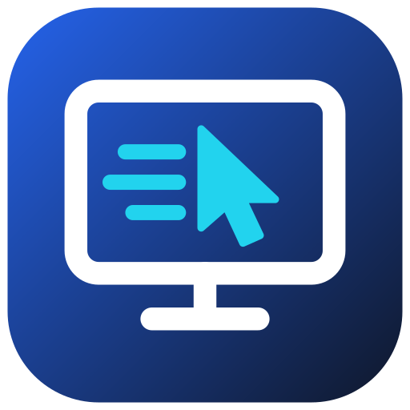
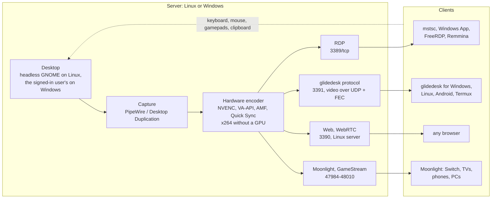
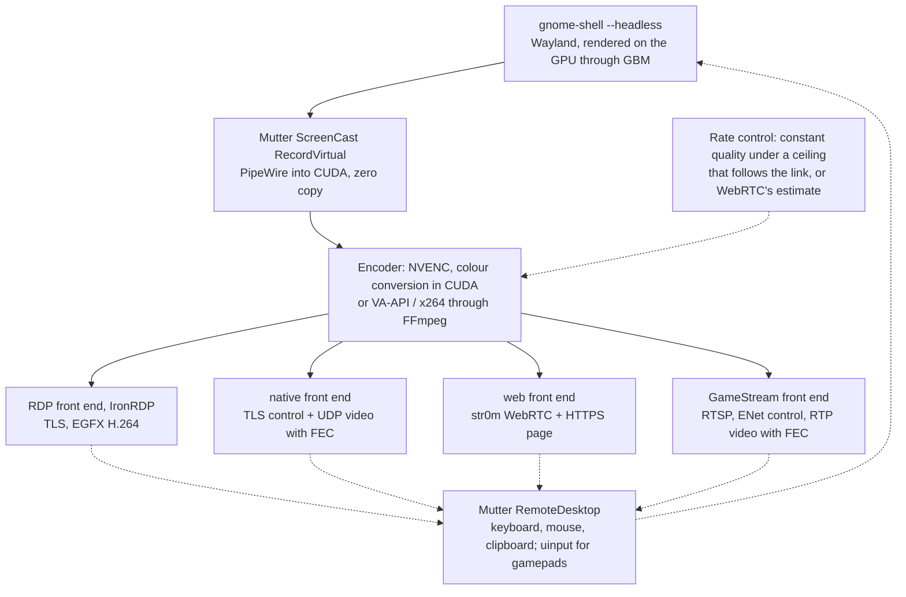

# glidedesk



A remote desktop for Linux that aims to feel like Windows RDP, or better:

- **The whole session is GPU-rendered**: each user gets a headless GNOME Shell (Wayland)
  composited on the GPU, with no physical monitor, dummy plug or virtual display driver.
- **The desktop follows the client window**: resize the window and the remote resolution
  changes.
- **Hardware video end to end**: NVENC on NVIDIA, VA-API on AMD and Intel (Quick Sync and
  AMF on Windows; x264 on the CPU when there is no usable GPU), low-latency settings, frames
  encoded as soon as the compositor produces them, up to the client's refresh rate (144 Hz
  and more).
- **Two ways in, at the same time**:
  - **Standard RDP** (port 3389): the Windows Remote Desktop client (`mstsc`), Microsoft's
    Windows App (macOS, iOS, Android) and FreeRDP/Remmina work without installing anything.
  - **glidedesk's own low-latency protocol** (port 3391): video over UDP with Reed-Solomon
    FEC (a lost packet never stalls the picture; a lost frame is recovered without a new
    keyframe on NVENC), HEVC or H.264, everything else over TLS.
    Used by the glidedesk clients for Windows, Linux, Android and Termux.
  - **Any web browser** (port 3390): open `https://<server>:3390`, log in, done. WebRTC
    carries the same hardware-encoded video (HEVC where the browser decodes it, else H.264),
    Opus sound, and the input; WebRTC's congestion control sets the bitrate.
- **No fixed bandwidth**: frames are encoded at a constant quality, so a still desktop costs
  almost nothing; only the ceiling a frame may reach follows the link, from the measured
  delay (it drops as soon as frames queue, and climbs back while the link is clean).

**Status: v0.4, usable; still young.** The Linux server is tested on Ubuntu 24.04 (GNOME 46)
and 26.04 (GNOME 50) with NVIDIA GPUs (VA-API encoding on AMD and Intel through WSL only). The
clients run on Windows, Linux, Android and Termux, plus anything with Moonlight or a browser.
The Windows server is a preview (see below).

## How it works



With NVENC each frame goes from the GPU that composed it to the encoder without passing through
the CPU, and is sent as soon as the desktop changes; a still desktop sends almost nothing.

## Quick start

Files are on the [releases page](https://github.com/PabloSoage/glidedesk/releases). Clients
log in with the server's user name and the password you give the server.

**1. Start the server**

- **Linux** (Ubuntu 24.04 or 26.04 with GNOME; take the host built for your Ubuntu):

  ```sh
  sudo apt install gnome-shell pipewire wireplumber dbus-daemon ffmpeg libopus0
  chmod +x glidedesk-host-linux-x86_64-ubuntu26.04 glidedesk-session.sh
  export GLIDEDESK_PASSWORD='choose-a-password'
  ./glidedesk-session.sh -- ./glidedesk-host-linux-x86_64-ubuntu26.04 serve --gamestream
  sudo ufw allow 3389/tcp && sudo ufw allow 3390 && sudo ufw allow 3391   # if ufw is on
  ```

- **Windows 10/11** (preview; shares the signed-in user's desktop), in PowerShell:

  ```powershell
  $env:GLIDEDESK_PASSWORD = 'choose-a-password'
  .\glidedesk-host-windows-x86_64.exe serve --bind 0.0.0.0:3392 --gamestream
  ```

  Windows asks to allow it through the firewall: allow it. (3389 is Windows' own Remote
  Desktop, hence 3392.)

`--gamestream` is only needed for Moonlight; for Moonlight also open 47984, 47989 and
48010/tcp and 47998-48000/udp.

**2. Connect**

| Client device | Use | How |
|---|---|---|
| Windows | `glidedesk-windows-x86_64.exe` (lowest latency) | run it, type the server and user, **Connect** |
| Windows | Remote Desktop, built in | `mstsc /v:<server>` (Windows server: `<server>:3392`) |
| Linux | `glidedesk-linux-x86_64-ubuntu24.04` or `-ubuntu26.04` | `glidedesk <server> --user <user>` |
| Linux | FreeRDP / Remmina | `xfreerdp3 /v:<server> /u:<user> /dynamic-resolution` |
| Android | `glidedesk-android.apk` | install, type server, user and password, **Low latency** |
| macOS, iOS, Android | Microsoft's Windows App (RDP) | add the server as a PC |
| Any device with a browser | nothing to install (Linux server) | `https://<server>:3390` |
| Nintendo Switch, TVs, iOS, macOS, Android | Moonlight (server with `--gamestream`) | add the server, then on the server: `glidedesk-host pair <PIN>` (with `GLIDEDESK_PASSWORD` set) |

The first time, accept the server's self-signed certificate (the glidedesk clients show its
fingerprint). The details of every server and client follow below.

## Which client?

| | `mstsc` / Windows App / FreeRDP (RDP) | glidedesk clients (native protocol) | Web browser (WebRTC) |
|---|---|---|---|
| Install | nothing (built into Windows) | one program (Windows, Linux, Android, Termux) | nothing |
| Transport | TCP (TLS) | video over UDP with FEC, the rest over TLS | WebRTC (UDP, DTLS-SRTP) |
| On a lossy link (Wi-Fi, mobile) | a lost packet stalls everything until it is resent | the picture keeps going | retransmission and keyframe requests, as video calls |
| Codec | H.264 4:2:0 | HEVC (where the client decodes it in hardware) or H.264 | HEVC (Chrome, Edge, Safari with hardware support) or H.264 |
| Decoding | the client's | on the GPU (D3D11VA on Windows, VA-API or NVDEC on Linux, MediaCodec on Android) | the browser's (GPU where available) |
| Refresh rate | the server's (`--refresh`, default 120) | the client's screen (60, 120, 144 Hz...) | the server's |
| Desktop follows the window | FreeRDP: yes. `mstsc`: not yet | yes | yes |
| Sound | yes | yes (desktop and Termux clients) | yes (Opus) |
| Clipboard | text and files | text (desktop client) | not yet |
| Pointer | drawn by the client | drawn by the client | drawn by the browser |

Use RDP or the browser when you cannot install anything; use the glidedesk client for the
lowest latency, especially over Wi-Fi or the Internet.

## Download

Prebuilt binaries are on the [releases page](https://github.com/PabloSoage/glidedesk/releases):

| File | What |
|---|---|
| `glidedesk-host-linux-x86_64-ubuntu24.04` | the server for Ubuntu 24.04 (GNOME 46, FFmpeg 6), x86-64 |
| `glidedesk-host-linux-x86_64-ubuntu26.04` | the server for Ubuntu 26.04 (GNOME 50, FFmpeg 8), x86-64 |
| `glidedesk-session.sh` | starts the headless GNOME session the server runs in |
| `glidedesk-host-windows-x86_64.exe` | the server for Windows 10/11 (preview: shares the signed-in user's desktop) |
| `glidedesk-windows-x86_64.exe` | desktop client for Windows |
| `glidedesk-linux-x86_64-ubuntu24.04`, `glidedesk-linux-x86_64-ubuntu26.04` | desktop client for Linux (Wayland or X11; uses the system FFmpeg: 6 on 24.04, 8 on 26.04) |
| `glidedesk-android.apk` | Android client (RDP or native protocol) |
| `glidedesk-x11-termux-aarch64` | client for Termux with termux-x11 (Android, arm64) |
| `glidedesk-x11-linux-x86_64` | the same small X11 client for Linux machines without a GPU |

## Server

Requirements: Ubuntu 24.04 (GNOME 46) or 26.04 (GNOME 50); other distributions with GNOME 46+
should work when built from source. For hardware encoding, the NVIDIA driver (570 or later)
or Mesa / Intel media VA-API drivers.

```sh
sudo apt install gnome-shell pipewire wireplumber dbus-daemon ffmpeg libopus0
chmod +x glidedesk-host-linux-x86_64-ubuntu26.04 glidedesk-session.sh
# Your Linux user name and a password for remote clients (not your login password,
# unless you want it to be):
export GLIDEDESK_PASSWORD='choose-a-password'
./glidedesk-session.sh -- ./glidedesk-host-linux-x86_64-ubuntu26.04 serve
```

`glidedesk-session.sh` starts a private headless GNOME Shell on its own D-Bus session (it does
not touch a desktop session you may already have) and runs the server next to it. Clients log
in with your Linux user name and `GLIDEDESK_PASSWORD`.

Open the ports if a firewall is active: **3389/tcp** (RDP), **3391/tcp + 3391/udp**
(native protocol) and **3390/tcp + 3390/udp** (web client), e.g.
`sudo ufw allow 3389/tcp && sudo ufw allow 3391 && sudo ufw allow 3390`.

Useful options of `serve` (`--help` lists them all):

| Option | Default | |
|---|---|---|
| `--encoder auto\|nvenc\|vaapi\|software` | `auto` | NVENC if there is an NVIDIA GPU, else VA-API, else x264; an encoder that cannot do HEVC (or hangs on it) serves H.264 |
| `--max-bitrate BPS` | none | a ceiling for metered or slow links (e.g. `8000000` for mobile data); without it the link decides |
| `--refresh HZ` | 120 | refresh rate for RDP clients (native clients use their own screen's) |
| `--bind`, `--native-bind`, `--web-bind` | `0.0.0.0:3389`, `0.0.0.0:3391`, `0.0.0.0:3390` | addresses; `--no-native` and `--no-web` turn those off |
| `--avc444` | off | full-chroma AVC444 for RDP clients (experimental: `mstsc` shows it blurred) |
| `--x11 :0` | | serve an existing X11 display instead of a GNOME session (see Termux below) |
| `--gamestream` | off | also answer Moonlight clients (see below) |

The TLS certificate is self-signed, created in `~/.config/glidedesk/` on first start.

### Apps instead of the whole desktop

List apps in `~/.config/glidedesk/apps.conf` (Windows: `%APPDATA%\glidedesk\apps.conf`), one
per line:

```text
# Name = command line, run in the session
Firefox = firefox
Terminal = gnome-terminal
```

A client that asks for one (`glidedesk <server> --app Firefox`, the **App** field of the
connection window, or `app = "Firefox"` in a `.glidedesk` profile) gets it started in the
session, and the session ends when the app does. An app that is already running is reused. On
Windows the app's window is maximized. On GNOME it opens as a normal window on the desktop; for
a host that serves only apps, start the session with GNOME Kiosk instead (every window full
screen, no desktop): `glidedesk-session.sh --kiosk -- glidedesk-host serve` (package
`gnome-kiosk`). The native protocol, the web page and Moonlight can choose an app; RDP clients
get the desktop (IronRDP does not pass on the client's alternate shell). Apps that start another
process and exit at once (launchers) keep the session open.

### Moonlight

With `--gamestream` the server listens on 47989/tcp and 47984/tcp like Sunshine, so Moonlight
(desktop, Android, iOS, TVs, Nintendo Switch, …) can find it and pair. Add the server in
Moonlight, which shows a PIN, and type it on the server:

```sh
GLIDEDESK_PASSWORD='...' glidedesk-host pair 1234    # without a PIN: lists who is waiting
```

Paired clients see the apps from `apps.conf` (plus **Desktop**) and can stream them: video in
H.264 or HEVC at the resolution, frame rate and bitrate chosen in Moonlight, stereo, 5.1 or 7.1
sound, keyboard and mouse. Streaming also uses 48010/tcp (RTSP), 47998/udp (video), 47999/udp
(control and input) and 48000/udp (sound). Video carries 20% Reed-Solomon parity, as Sunshine's,
so lost packets are rebuilt on Wi-Fi. Input and sound are always encrypted; video is encrypted
when the client wants it (Moonlight on a PC with AES instructions always does) and always for
clients outside private networks (anything but 10/8, 172.16/12, 192.168/16, 100.64/10, IPv6
fc00::/7 and link-local). On GNOME the session's sound output is 7.1, so games and players can
send surround; RDP and browsers get it mixed down to stereo.

Each controller on the client becomes a virtual Xbox 360 pad in the session, with rumble going
back to the client. On Linux this needs write access to `/dev/uinput`, which is root's only by
default; a udev rule like Sunshine's gives it to a group:

```sh
echo 'KERNEL=="uinput", SUBSYSTEM=="misc", OPTIONS+="static_node=uinput", GROUP="uinput", MODE="0660"' |
  sudo tee /etc/udev/rules.d/60-glidedesk-uinput.rules
sudo groupadd -f uinput && sudo usermod -aG uinput "$USER"   # then log in again
sudo udevadm control --reload && sudo udevadm trigger --name-match=uinput
```

Anyone in that group can create input devices, so add only the user the server runs as. On
Windows the pads need the [ViGEmBus](https://github.com/nefarius/ViGEmBus/releases) driver.
Not done yet: touch and pen (Moonlight turns them into mouse input for now), and gyro.

If the "Stop screen sharing" button in GNOME's top bar is pressed, the server starts a new
session by itself within about a second; clients stay connected. Windows that were full
screen or maximized come back as normal windows (Mutter moves them off the closed monitor).

## Clients

### Windows: Remote Desktop (`mstsc`)

`mstsc /v:<server>`, user name = your Linux user, password = `GLIDEDESK_PASSWORD`. Accept the
self-signed certificate the first time. Full screen works; resizing the `mstsc` window does
not change the remote resolution yet (FreeRDP's `/dynamic-resolution` does).

### Windows and Linux: `glidedesk`

Started with no arguments it opens a connection window in the manner of `mstsc`: computer
(with the recent ones), user, and the options in tabs (protocol and port, size and full
screen, codec, GPU, sound, clipboard, trusted servers). The options can be saved as a
`.glidedesk` file and opened again, or given on the command line:

```sh
glidedesk                                    # the connection window
glidedesk work.glidedesk                     # a saved connection
glidedesk <server> --user <user>             # native protocol (UDP), the default
glidedesk <server> --user <user> --rdp       # RDP instead
glidedesk <server> --user <user> --fullscreen --width 1920 --height 1080
```

On Windows it asks for the password with the standard Windows sign-in dialog and can remember
it (Credential Manager); a wrong password is forgotten. A shortcut with those arguments is all
you need. On Linux give it with `--password` or the `GLIDEDESK_PASSWORD` variable. The window
menu (right click on the title bar) has **Full screen** and **Show log**; the log is in
`%LOCALAPPDATA%\glidedesk\glidedesk.log` (Linux: `~/.local/state/glidedesk/glidedesk.log`).

The remote desktop takes the window's size and follows it when you resize. Video is decoded
on the GPU (D3D11VA on Windows, with NVIDIA, AMD and Intel alike; VA-API or NVDEC on Linux),
in HEVC when the GPU decodes HEVC, else H.264; without a usable GPU decoder FFmpeg decodes in
software. `--software-decode` forces the CPU (and H.264). With more than one GPU, `--gpu amd`,
`--gpu intel` or `--gpu nvidia` picks the one that decodes and draws (a laptop's integrated GPU,
say); the picture still shows on whichever screen the window is on. `--codec h264` or
`--codec hevc` overrides the automatic choice; `--no-clipboard` keeps the clipboard local.

The first connection to a server shows the SHA-256 fingerprint of its certificate and asks
whether to trust it, before any password is sent; the answer is remembered
(`%APPDATA%\glidedesk\known_hosts.toml`; on Linux, `~/.config/glidedesk/known_hosts.toml`,
where there is no dialog yet and the first certificate is trusted). A server that later shows
a different certificate is refused until it is forgotten (the **Advanced** tab of the
connection window). `--fingerprint <hex>` pins one without asking. To read it on the server:
`openssl x509 -in ~/.config/glidedesk/cert.pem -outform der | sha256sum`.

### Any browser

Open `https://<server>:3390` (accept the self-signed certificate the first time), enter the
user name and `GLIDEDESK_PASSWORD`. The desktop takes the browser window's size; **Full
screen** (top right, where the frame rate and bitrate also show) also captures keys such as
Alt+Tab where the browser allows it (Chrome, Edge). Works on phones and tablets too.

### Android

Install `glidedesk-android.apk`, enter the server, user and password, and choose **Low
latency** (native protocol, hardware HEVC/H.264 decoding, the phone's refresh rate) or plain
RDP. Touch moves the pointer; the keyboard button opens the on-screen keyboard.

### Termux (Android) with termux-x11

A small client that draws into an X11 display, for phones and tablets where you already use
[Termux](https://termux.dev) and [termux-x11](https://github.com/termux/termux-x11):

```sh
pkg install x11-repo && pkg install termux-x11-nightly pulseaudio
pulseaudio --start --exit-idle-time=-1
termux-x11 :0 &        # then open the Termux:X11 app
chmod +x glidedesk-x11-termux-aarch64
DISPLAY=:0 GLIDEDESK_PASSWORD='...' ./glidedesk-x11-termux-aarch64 --user <user> <server>
```

It fills the screen (`--width`/`--height` for a window), plays sound through PulseAudio
(`--mute` to turn it off), and takes `--rdp` too. The same program runs on any X11 desktop
(`glidedesk-x11-linux-x86_64`).

## Serving an X11 display (Termux, X11 desktops)

The server can also share an existing X11 display instead of starting a GNOME session: an
XFCE desktop in termux-x11 on a phone, or a Linux desktop running on X.

```sh
# Termux: build it on the device (no prebuilt binary yet)
pkg install rust clang ffmpeg pulseaudio
cargo build --release -p glidedesk-host --no-default-features --features x11
GLIDEDESK_PASSWORD='...' target/release/glidedesk-host serve --x11 :0 --encoder software
```

The display keeps its own size; input goes through XTEST, sound through PulseAudio.

## Serving a Windows desktop (preview)

The server also runs on Windows 10/11 and shares the desktop of the signed-in user: Desktop
Duplication for the picture, NVENC, Quick Sync or AMF for the video (x264 without them), the
default output for sound, the clipboard (text and, with RDP clients, files), Moonlight with `--gamestream` and gamepads through ViGEmBus. When the desktop is drawn on the NVENC GPU
(also inside a Remote Desktop session on Windows Server with an NVIDIA GPU), frames go to the
encoder without leaving the GPU. Clients connect with the native protocol or RDP; the web
client is not there yet.

```powershell
$env:GLIDEDESK_PASSWORD = '...'
glidedesk-host serve --bind 0.0.0.0:3392    # 3389 belongs to Windows' own Remote Desktop
```

The user name is the Windows one. Allow the program in the firewall (3391 TCP and UDP, and
the RDP port). It is an ordinary program for now: it cannot see or drive the lock screen or
UAC prompts, the desktop keeps the monitor's size (with several monitors, the primary one is
shared), and the PC needs a monitor or a dummy plug. Inside a Remote Desktop session it works
only while that session is shown: a minimized `mstsc` window stops its drawing.

## Building from source

```sh
# Server (Ubuntu 24.04):
sudo apt install libpipewire-0.3-dev libspa-0.2-dev libclang-dev clang libegl-dev libgbm-dev \
  libavcodec-dev libavformat-dev libavutil-dev libswscale-dev libavfilter-dev \
  libavdevice-dev libswresample-dev libva-dev libasound2-dev libssl-dev libopus-dev \
  cmake pkg-config
cargo build --release -p glidedesk-host --features x11
# Desktop client, Linux (FFmpeg from the system: libavcodec-dev, plus libva for VA-API):
cargo build --release -p glidedesk-desktop
# Desktop client, Windows: FFmpeg is linked in from vcpkg (vcpkg.json). Needs Visual Studio
# or Build Tools with the "vcpkg package manager" component, and LLVM (winget install
# LLVM.LLVM) for the bindings. The first run builds FFmpeg (~10 minutes).
scripts\build-windows.ps1
# Server, Windows: the same, with FFmpeg's encoders (the "host" feature of vcpkg.json).
scripts\build-windows.ps1 --host
# Termux client, cross-compiled:
cargo ndk -t arm64-v8a build --release -p glidedesk-x11
# Android app (Gradle; builds the Rust core with cargo-ndk):
cd android && ./gradlew assembleRelease
```

For development, `scripts/dev-serve.sh` restarts the server and its session in the background
(log in `$XDG_RUNTIME_DIR/glidedesk-serve.log`) and `scripts/dev-session.sh` runs any command
next to a private headless GNOME Shell (it is the release's `glidedesk-session.sh`).

## Design



The last client to connect, on either protocol, gets the session; the previous one is told
why it was disconnected.

## License

GPL-3.0-or-later. See [THIRD_PARTY.md](THIRD_PARTY.md) for bundled and derived code.
